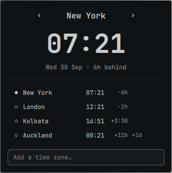

# Omarchy World Clock

A bar widget for the [Omarchy](https://omarchy.org/) shell that shows the time in several time zones. You add zones by searching for a city.



- The bar shows every saved zone inline: `NYC 07:21 · LON 12:21`.
- Click the widget to open a popup with the active zone, its date, and how far it is ahead of or behind your local time.
- The `‹` and `›` arrows step through your saved zones.
- The list shows each zone's time and offset, with `+1d` or `-1d` when its date differs from yours.

## Requirements

- Omarchy with the Quickshell-based shell (`omarchy-shell`). Built and tested on Omarchy 4.0.4.
- `curl`, for the city search. The clock itself works offline.

## Install

1. Add and enable the plugin:

   ```bash
   omarchy plugin add https://github.com/TheAmbitiousCorry/omarchy-world-clock.git --enable
   ```

   The widget appears in the center section of the bar with one zone, New York.

2. To place the widget next to the weather, move it:

   ```bash
   omarchy bar move kr34t1v.world-clock --before omarchy.weather
   ```

Omarchy plugins run unsandboxed inside the shell. Read the code before you enable it.

## Use

| To do this | Do this |
|---|---|
| Open or close the popup | Click the widget |
| Switch the active zone | Click `‹` or `›`, press Left or Right, or click a row |
| Add a zone | Type a city in "Add a time zone…", choose with Down and Up, press Return |
| Remove a zone | Hover its row and click `✕` |
| Clear the search, then close | Press Escape once, then again |

## Settings

Settings live on the widget's entry in `~/.config/omarchy/shell.json`. The shell reloads the file on save.

| Key | Default | Meaning |
|---|---|---|
| `zones` | New York | Saved zones, in display order. Each is `{ "label", "name", "country", "timezone" }`, where `timezone` is an IANA name such as `Europe/London`. |
| `active` | first zone | IANA name of the zone the popup opens on. |
| `format` | `"HH:mm"` | Qt time format. `"h:mm AP"` gives a 12-hour clock. |
| `maxInline` | `"auto"` | How many zones the bar shows before collapsing the rest into `+N`. `"auto"` shows 2 on screens narrower than 1400 px and 4 otherwise. A positive integer applies to every screen. |

The `label` is the short code the bar shows. The plugin derives it when you add a zone (`NYC`, `LON`, or the first letters of the city). Edit `label` in `shell.json` to change it.

Example entry:

```json
{
  "id": "kr34t1v.world-clock",
  "format": "HH:mm",
  "maxInline": 3,
  "zones": [
    { "label": "NYC", "name": "New York", "country": "United States", "timezone": "America/New_York" },
    { "label": "LON", "name": "London", "country": "United Kingdom", "timezone": "Europe/London" }
  ],
  "active": "America/New_York"
}
```

## IPC

The plugin registers the IPC target `kr34t1v.world-clock`, so you can bind its functions to keys:

```bash
omarchy-shell kr34t1v.world-clock toggle
```

| Function | Effect |
|---|---|
| `open`, `close`, `toggle` | Show or hide the popup |
| `next`, `previous` | Step the active zone |
| `add` | Open the popup with the search field focused |

## How it gets the time

- Offsets come from the system zone database: the plugin runs `TZ=<zone> date +%z` for each saved zone once a minute. A daylight-saving change shows within a minute.
- City search uses the [Open-Meteo geocoding API](https://open-meteo.com/en/docs/geocoding-api). The plugin sends only the text you type, and only while you search.

## Known limits

- On a vertical bar the widget shows a globe icon instead of the zone text.
- After editing the plugin's QML, run `omarchy restart shell` if the change does not appear. Hot-reload missed some edits during development.

## Develop

Run the model tests with Node:

```bash
node test/model.test.js
```

Validate the manifest:

```bash
omarchy plugin validate .
```

## License

MIT. See [LICENSE](LICENSE).
